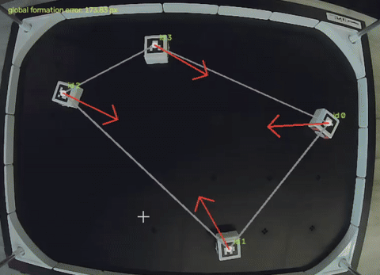

# Multi-Robot Formation Control with Differential-Drive Robots

An introductory tutorial on multi-robot formation control using **HamsterS differential-drive robots**, an overhead camera, and **ArUco markers**. A centralized Python controller estimates each robot's position and orientation, computes control vectors from desired relative positions, and converts those vectors into wheel commands to establish a circular formation.

## Objectives

This tutorial covers:

- Detecting and tracking multiple robots with OpenCV and ArUco markers.
- Defining a desired circular formation using relative displacement vectors.
- Computing formation errors and control vectors for each robot.
- Converting control vectors into differential-drive wheel commands.
- Integrating localization, formation control, and basic reactive obstacle avoidance in a continuous control loop.

## System Overview

Each robot carries a unique ArUco marker visible to a stationary overhead camera. The computer uses the camera measurements to estimate robot poses, compare the current arrangement with the desired formation, and send wheel commands to the robots through RoboID.

The example implementation uses **fixed formation assignments**: each robot moves toward its assigned position relative to the other robots, rather than converging to a shared point.

## Requirements

- Two or more HamsterS robots
- An overhead USB camera and one ArUco marker per robot
- Python 3.10 or newer
- NumPy, OpenCV with the ArUco module, and RoboID

Install the Python dependencies:

```bash
python -m pip install numpy opencv-contrib-python roboid
```

## Tutorial Outline

1. **Robot tracking:** Identify markers and estimate each robot's position and heading.
2. **Formation definition:** Assign positions around a circle and calculate desired pairwise displacements.
3. **Formation control:** Compute the difference between actual and desired relative positions.
4. **Robot motion:** Convert each control vector into turning and forward wheel commands.
5. **Execution:** Run the camera-based feedback loop and observe the resulting formation.

## Demonstration

The tutorial includes demonstrations of the robots moving into a circular formation and using proximity sensors for basic reactive obstacle avoidance.



## Summary

This project provides a practical introduction to multi-robot perception and coordinated control with physical differential-drive robots. It demonstrates how overhead visual tracking, relative-position control, and robot actuation can be combined into a working formation-control system.
