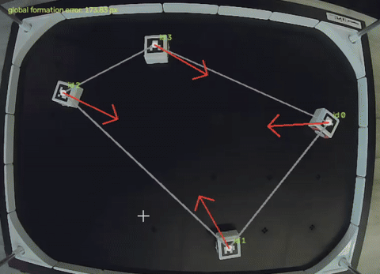

# Multi-Robot Formation Control with Differential-Drive Robots

A tutorial on multi-robot formation control using **HamsterS differential-drive robots**, an overhead camera, and **ArUco markers**. The implementation tracks robot poses with OpenCV, computes formation-control vectors from relative positions, and converts those vectors into wheel commands.

The complete instructions, code explanations, and demonstrations are available in the **[full tutorial](TUTORIAL.md)**.

## Objectives

This tutorial introduces how to:

- Detect and track multiple robots using ArUco markers and an overhead camera.
- Define a circular formation using desired relative displacement vectors.
- Calculate formation errors and control vectors for each robot.
- Convert control vectors into differential-drive wheel commands.
- Integrate robot localization, formation control, and reactive obstacle avoidance.

## Tutorial

The following links jump directly to the corresponding sections of the full tutorial:

1. [System overview and project structure](TUTORIAL.md#2-system-overview)
2. [Hardware setup and ArUco markers](TUTORIAL.md#3-hardware)
3. [Software requirements and controller settings](TUTORIAL.md#4-software-requirements)
4. [Robot pose tracking](TUTORIAL.md#5-tracking-robot-poses) — [marker detection](TUTORIAL.md#aruco-marker-detection), [position](TUTORIAL.md#finding-robot-position), and [orientation](TUTORIAL.md#finding-robot-orientation)
5. [Formation control](TUTORIAL.md#6-formation-control) — [circular formations](TUTORIAL.md#circular-formation), [desired displacements](TUTORIAL.md#desired-pairwise-displacements), and [control vectors](TUTORIAL.md#formation-error-and-control-vector)
6. [Differential-drive robot motion](TUTORIAL.md#7-converting-a-vector-into-robot-motion) — including [reactive obstacle avoidance](TUTORIAL.md#reactive-obstacle-avoidance)
7. [Main control loop and implementation](TUTORIAL.md#8-main-control-loop)
8. [Running the tutorial](TUTORIAL.md#9-running-the-tutorial)
9. [Expected results and real-robot demonstration](TUTORIAL.md#10-expected-result)
10. [Troubleshooting](TUTORIAL.md#11-troubleshooting)

## Requirements

- Two or more HamsterS robots
- An overhead USB camera and one ArUco marker per robot
- Python 3.10 or newer
- NumPy, OpenCV (ArUco), and RoboID

Install the Python dependencies:

```bash
python -m pip install numpy opencv-contrib-python roboid
```

For setup details and controller parameters, see [Hardware](TUTORIAL.md#3-hardware) and [Software Requirements](TUTORIAL.md#4-software-requirements).

## Demonstration

The tutorial demonstrates physical robots moving toward a circular formation and using proximity sensors for basic obstacle avoidance.

See the [real-robot demonstration](TUTORIAL.md#real-robot-demonstration) and [reactive obstacle avoidance](TUTORIAL.md#reactive-obstacle-avoidance) sections.



## Summary

The tutorial combines overhead camera-based localization, pairwise formation control, and differential-drive actuation in a simple multi-robot system. See the [full tutorial summary](TUTORIAL.md#13-summary).
