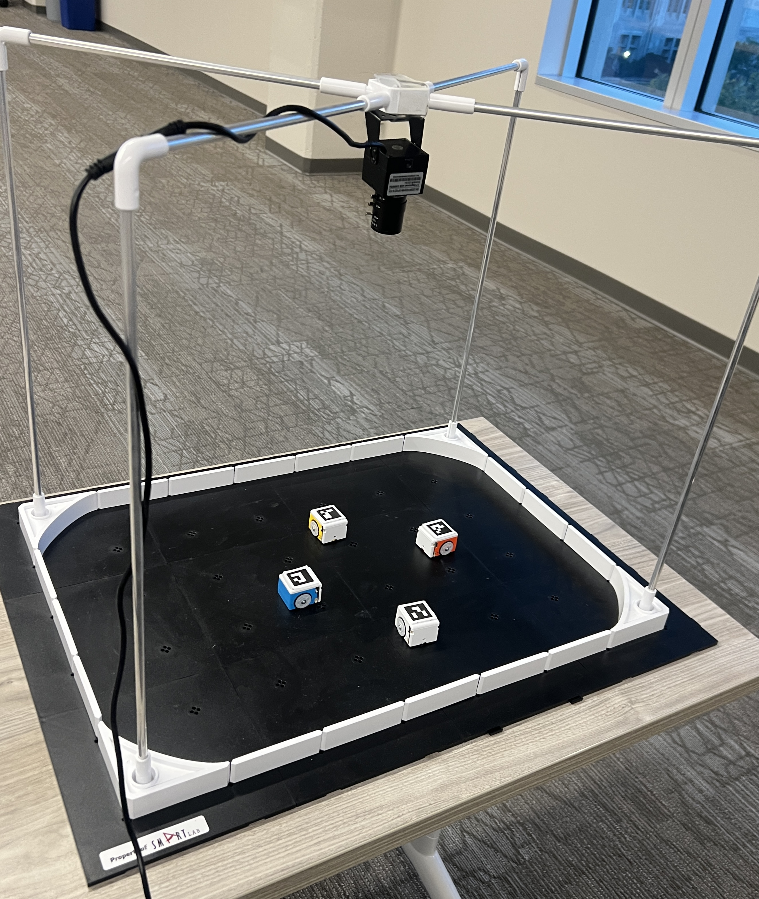
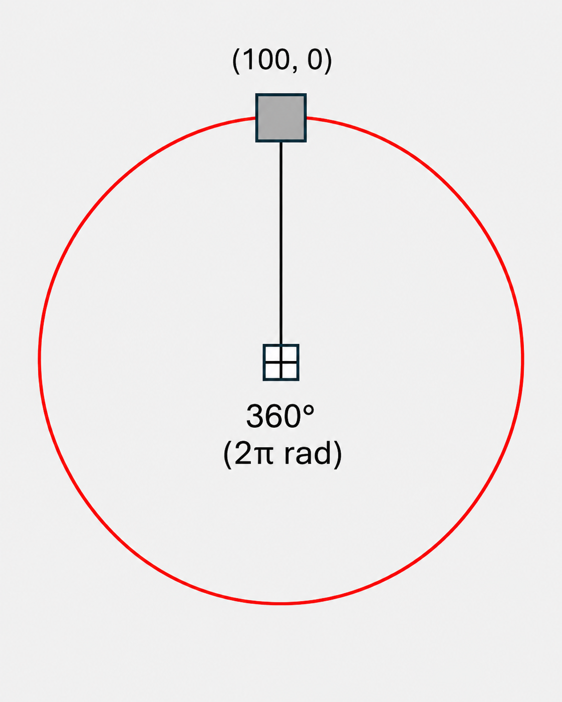
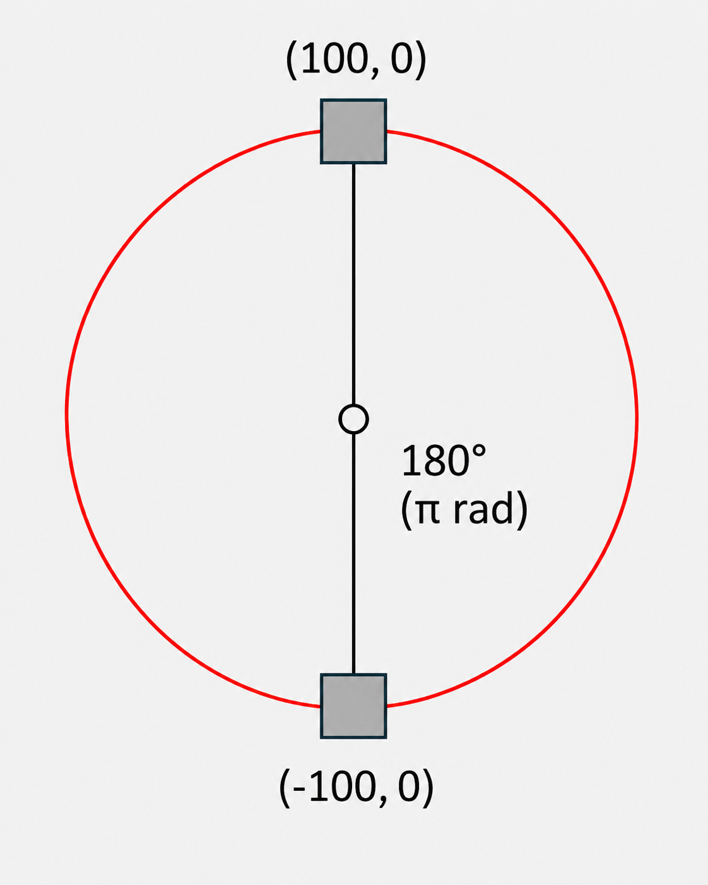
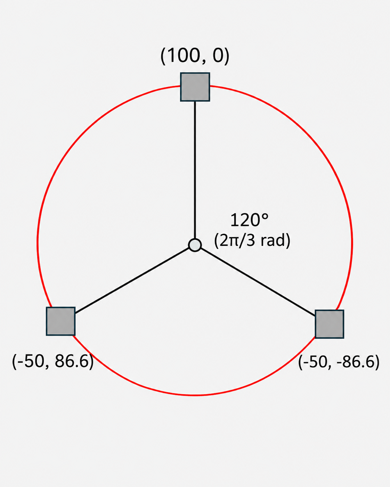
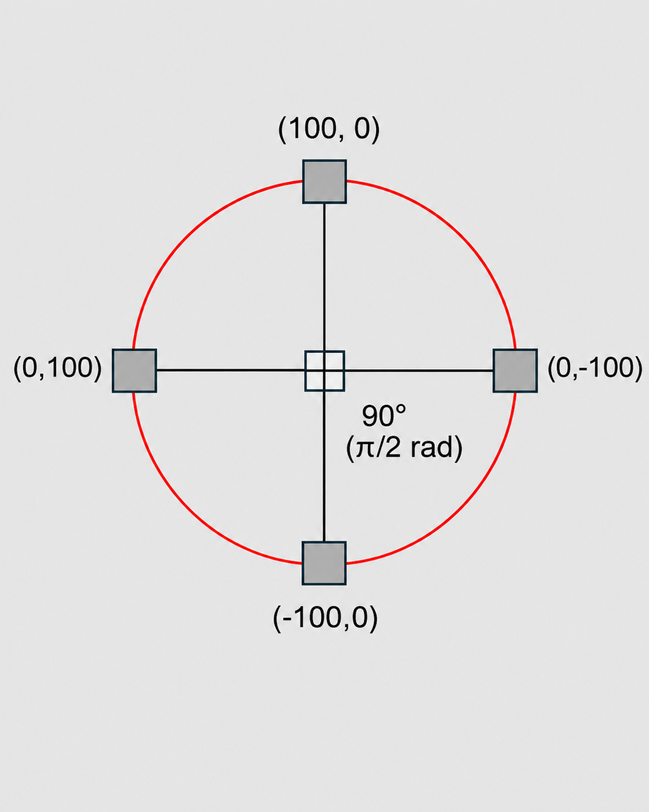
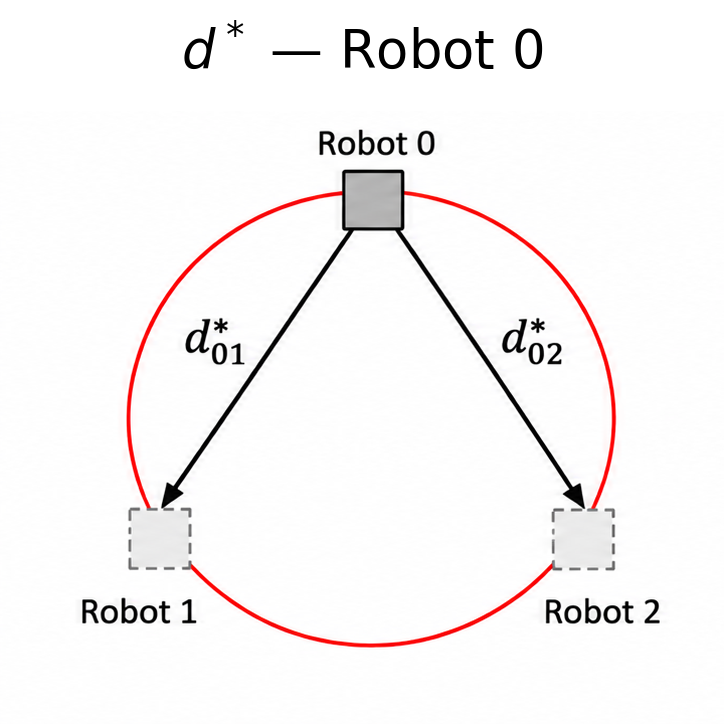
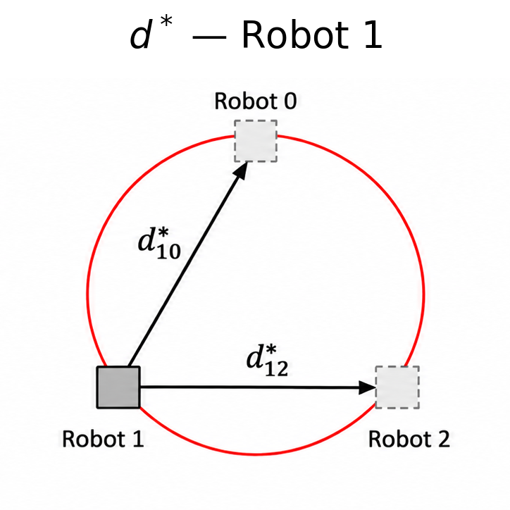
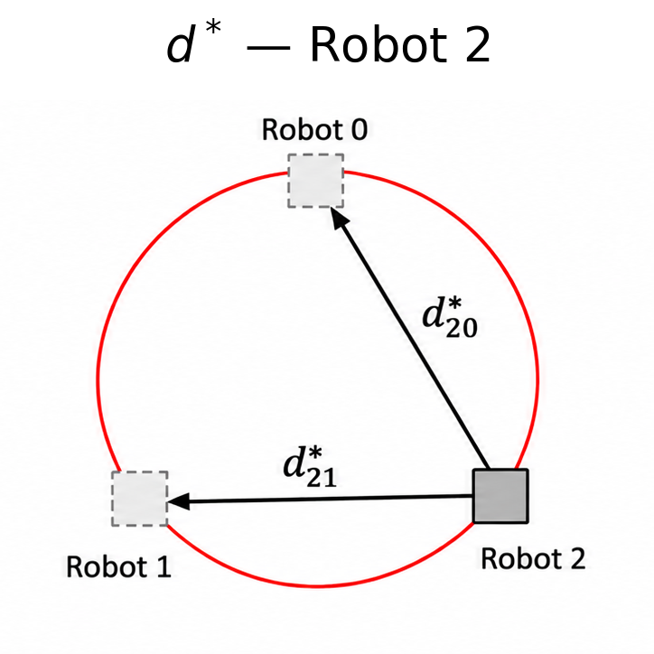

# Multi-Robot Formation Control with Differential Drive Robots

This tutorial introduces the basic concepts of a multi-robot system by implementing formation control for HamsterS differential-drive robots.

In formation control, a team of robots attempts to achieve and maintain a desired spatial arrangement. Here, each robot uses its measured position and the team's desired relative displacement vectors to determine how it should move. An overhead camera detects ArUco markers to estimate robot positions and orientations, and a Python program converts the resulting formation-control vectors into wheel commands.

## 1. Objectives

By the end of the tutorial, you should understand how to:

1. Detect and identify multiple robots using ArUco markers.
2. Estimate each robot's position and orientation from camera images.
3. Define a circular formation using relative displacement vectors.
4. Calculate formation errors and control vectors for each robot.
5. Convert control vectors into differential-drive wheel commands.
6. Integrate perception and control into a continuous control loop.

The system uses fixed formation-slot assignments, meaning each robot is assigned a predetermined position within the desired formation. The goal is to establish the circular arrangement, not to bring all robots to the same point.

## 2. System Overview

The system uses a stationary USB camera above the operating area. A unique ArUco marker is attached to the top of each robot. OpenCV identifies the markers and estimates each robot's position and heading in image coordinates.

The Python program compares the robots' current pairwise displacements with those required by a circular formation. It then computes a two-dimensional movement vector for each robot and sends robot-specific wheel commands through RoboID. The calculation is centralized: a single computer receives the camera image and controls all the robots.

### Project Structure

```text
project/
├── main.py
├── settings.py
└── utils/
    ├── camera_supervisor.py
    ├── formation_control.py
    ├── actuation.py
    └── img_overlay.py
```

- `main.py`: Initializes robots and runs the control loop.
- `settings.py`: Stores robot IDs, formation parameters, controller gains, and thresholds.
- `camera_supervisor.py`: Detects ArUco markers and estimates robot poses.
- `formation_control.py`: Generates the desired formation and relative displacements.
- `actuation.py`: Converts control vectors into wheel commands.
- `img_overlay.py`: Optionally displays robot positions, control vectors, and formation error.

## 3. Hardware

### Requirements

- Robots: Two or more HamsterS robots (or equivalent differential-drive robots).
- Camera: One overhead USB camera, preferably capable 1080p resolution.
- ArUco Markers: One printed ArUco marker per robot.
- Computer: A computer capable of running Python.

Note: Other robots may require changes to the robot-specific control API, library calls, and wheel-command units. The formation equations and pose-estimation approach are not specific to HamsterS.

### Generating Markers

The following example generates marker ID 15 from the DICT_7X7_100 ArUco dictionary, matching the first ID in the example configuration:

```python
import cv2
dictionary = cv2.aruco.getPredefinedDictionary(
   cv2.aruco.DICT_7X7_100
)
marker = cv2.aruco.generateImageMarker(
   dictionary,
   15,  # Marker ID
   500,  # Image size in pixels
)
cv2.imwrite("marker_15.png", marker)
```

Generate a different marker ID for each robot and use the same dictionary during detection. Print markers flat, with a clear white margin, and secure them so they do not rotate relative to the robot.

Orientation convention: The top edge of the generated marker image should point toward the front of the robot. The orientation estimator assumes this mounting direction.

### Camera placement

Secure the camera above the operating area, approximately perpendicular to the floor. Keep all markers within view and ensure adequate, consistent lighting. Auto-focus hunting and motion blur can reduce detection reliability; fixed focus can help.

<p align="center">
  
</p>
<p align="center"><em>Figure 1. Experimental setup with an overhead camera and four HamsterS robots.</em></p>

## 4. Software Requirements

The implementation uses:

- Python 3.10 or newer for the main program (the `RobotAgent` type hints use `| None`).
- NumPy for array and vector calculations.
- OpenCV, with the ArUco module, for image capture and marker detection.
- RoboID for HamsterS communication and wheel commands.

Install the Python dependencies:

```bash
python -m pip install numpy opencv-contrib-python roboid
```

The actual controller imports the HamsterS class using:

```python
from roboid import *
```

For different robot platforms, use the relevant manufacturer's Python SDK or control API.

### Controller Settings

The relevant values in `settings.py` are:

```python
target_ids = [15, 16, 17, 90]
ROBOTS_N = 4
SHAPE_R = 100
KP_DISTANCE = 0.7
KP_ANGLE = 0.5
DISTANCE_THRESHOLD = 10  # Control-vector magnitude, pixels
ANGLE_THRESHOLD = 30    # Degrees
OBS_THRESHOLD = 70
OBS_SPEED = 50
```

The `target_ids` list determines the robot connection order: marker ID 15 corresponds to robot index 0, ID 16 to index 1, ID 17 to index 2, and ID 90 to index 3. Connect the physical robots in this order. Marker IDs are not RoboID connection IDs.

`SHAPE_R` is measured in image pixels; the gains and thresholds are explained where they are used below.

## 5. Tracking Robot Poses

### ArUco Marker Detection

Create a detector using the same dictionary used to print the markers:

```python
import cv2
aruco_dict = cv2.aruco.getPredefinedDictionary(cv2.aruco.DICT_7X7_100)
detector = cv2.aruco.ArucoDetector(aruco_dict)
```

For each camera frame:

```python
corners, ids, rejected = detector.detectMarkers(frame)
```

The detector returns:

- `corners`: One array of four corner coordinates for each successfully identified marker.
- `ids`: Corresponding marker IDs, or `None` if no markers were identified.
- `rejected`: Candidate marker regions that could not be identified; these are not used here. It is not a Boolean.

OpenCV returns the detected marker corners in the order top-left, top-right, bottom-right, bottom-left, relative to the marker's encoded orientation. Each `corners[k]` corresponds to `ids[k]`.

```python
if ids is not None:
    for marker_corner, marker_id in zip(corners, ids.flatten()):
        marker_corner = marker_corner.reshape((4, 2))
        print(f"Detected marker ID: {int(marker_id)}")
```

Optional visual check: To display the detected marker outlines and IDs on the camera image, add the following after `detectMarkers` (this is not part of the original display behavior):

```python
if ids is not None:
    cv2.aruco.drawDetectedMarkers(frame, corners, ids)
```

### Finding Robot Position

The robot position is estimated using the center of its ArUco marker. This is calculated by averaging the x and y coordinates of the marker’s four corners.

For marker corners $`(c_0,c_1,c_2,c_3)`$, the center is:

```math
p_i = \frac{c_0+c_1+c_2+c_3}{4}
```

Where:

- $`p_i = [x_i,y_i]`$: Estimated position of robot $`i`$ in image coordinates.
- $`c_0,c_1,c_2,c_3`$: The four detected ArUco marker corners, each represented as an $`(x,y)`$ coordinate.
- $`i`$: Index identifying a robot.

Example:

```python
marker_corners = corners[index][0]
center = marker_corners.mean(axis=0)
x = center[0]
y = center[1]
```

The robot positions are represented directly in camera pixel coordinates. The image origin is at the top-left, with x increasing rightward and y increasing downward. The marker center approximates the robot center only if the marker is mounted centrally.

### Finding Robot Orientation

The robot heading is estimated using the direction from the bottom edge of the ArUco marker toward its top edge.

<p align="center">
  
</p>
<p align="center"><em>Figure 2. ArUco marker heading direction and orientation angle.</em></p>

OpenCV uses the zero-based corner indices $`c_0`$ to $`c_3`$. The controller computes angles using image coordinates, where the positive y-direction points downward.

First, the midpoint of the top edge and the midpoint of the bottom edge are calculated:

```python
top_center = (topLeft + topRight) / 2
bottom_center = (bottomLeft + bottomRight) / 2
```

The heading vector is then calculated from the bottom-edge midpoint to the top-edge midpoint:

```python
heading_vector = top_center - bottom_center
```

The orientation of the robot is calculated from this heading vector:

```python
theta = math.degrees(
   math.atan2(
       heading_vector[1],
       heading_vector[0]
   )
)
```

The measured heading is in degrees. Normalize it to the range $`[0^\circ,360^\circ)`$:

```python
theta %= 360
```

The robot pose can be written as $`[x,y,\theta]`$, where $`\theta`$ is the heading measured from the positive image x-axis. In image coordinates, positive angles increase clockwise. The actual `RobotAgent` stores `position` and `orientation` as separate fields.

### Updating Poses Safely

`update_poses()` belongs in `utils/camera_supervisor.py`. It updates each robot object with the current frame's measured position and orientation.

A necessary safety correction is to reset every pose before detecting markers in each new frame. Otherwise, the earlier version of `update_poses` can leave stale robot positions when no marker is detected. Inside that function, use:

```python
def update_poses(ROBOTS, frame):
    for robot in ROBOTS.values():
        robot.position = None
        robot.orientation = None
    corners, ids, _ = detector.detectMarkers(frame)
    if ids is None:
        return
    for marker_corner, marker_id in zip(corners, ids.flatten()):
        marker_id = int(marker_id)
        if marker_id not in ROBOTS:
            continue
        c = marker_corner.reshape((4, 2))
        topLeft, topRight, bottomRight, bottomLeft = c
        heading = ((topLeft + topRight) - (bottomLeft + bottomRight)) / 2
        ROBOTS[marker_id].position = c.mean(axis=0)
        ROBOTS[marker_id].orientation = (
            math.degrees(math.atan2(heading[1], heading[0])) % 360
        )
```

This function requires `import math`, `import numpy as np`, and an initialized ArUco `detector` in `camera_supervisor.py`. It resets missing poses in both partially detected and entirely missed frames. The uploaded `camera_supervisor(8).py` needs this correction: its current early return can leave old poses when all markers disappear.

## 6. Formation Control

The goal of formation control is for all robots to move toward a desired spatial arrangement. Unlike rendezvous, the robots do not converge to a single location; the desired relative spacing is nonzero.

The formation controller uses the relative positions between each pair of robots. It compares their current relative positions with the desired relative positions defined by the target formation.

### Circular Formation

In this project, the desired formation places the robots at equally spaced points around a circle. The angular spacing is calculated by dividing $`2\pi`$ radians by the number of robots. This produces a set of formation coordinates centered at the origin, $`(0,0)`$.

These formation coordinates are stored in $`P^*`$:

```math
p_i^* = \begin{bmatrix}
R\cos\left(\frac{2\pi i}{N}\right) \\
R\sin\left(\frac{2\pi i}{N}\right)
\end{bmatrix}, \qquad i=0,\ldots,N-1
```

Where:

- $`P^*`$: The array containing all desired formation positions $`p_i^*`$.
- $`N`$ (`ROBOTS_N`): Number of robots.
- $`R`$ (`SHAPE_R`): Desired formation radius, in image pixels.
- $`i`$: Robot's fixed formation slot index, starting at 0.
- $`2\pi/N`$: Angular spacing between consecutive slots.

<table>
  <tr>
    <td align="center" width="25%"></td>
    <td align="center" width="25%"></td>
    <td align="center" width="25%"></td>
    <td align="center" width="25%"></td>
  </tr>
  <tr>
    <td align="center"><em>N = 1</em></td>
    <td align="center"><em>N = 2</em></td>
    <td align="center"><em>N = 3</em></td>
    <td align="center"><em>N = 4</em></td>
  </tr>
</table>
<p align="center"><em>Figure 3. Desired circular formations for different numbers of robots (R = 100 pixels).</em></p>

For four robots, these points lie around a circle and form a square (diamond-shaped relative to the image axes). Their coordinates specify the formation's relative geometry, not a fixed location in the camera image.

```python
def p_star():
    desired_positions = np.zeros((settings.ROBOTS_N, 2))
    for k in range(settings.ROBOTS_N):
        th = 2 * np.pi * k / settings.ROBOTS_N
        desired_positions[k] = [
            settings.SHAPE_R * np.cos(th),
            settings.SHAPE_R * np.sin(th),
        ]
    return desired_positions
```

The center-to-center spacing between adjacent formation slots is:

```math
d_{\mathrm{adjacent}}=2R\sin\left(\frac{\pi}{N}\right)
```

For `ROBOTS_N = 4` and `SHAPE_R = 100`, adjacent slots are approximately 141.4 pixels apart. This helps when choosing a radius large enough for physical clearance.

### Desired Pairwise Displacements

The desired displacement vectors between robots $`i`$ and $`j`$ are calculated from the coordinates in $`P^*`$ and stored in $`d^*`$:

```math
d_{ij}^* = p_j^* - p_i^*
```

Where:

- $`d_{ij}^*`$: Desired displacement vector pointing from robot $`i`$ to robot $`j`$.
- $`p_i^*`$ and $`p_j^*`$: Desired positions of the fixed formation slots for robots $`i`$ and $`j`$.
- `d_star(ROBOTS, desired_positions)`: Builds the desired-displacement array using each robot's assigned `slot`.

The three diagrams below show the desired displacement vectors from each robot's assigned formation slot to the other two slots in a three-robot circle. Solid squares denote the robot whose vectors are being shown; dashed squares mark the other target slots.

<table>
  <tr>
    <td width="33%" align="center"></td>
    <td width="33%" align="center"></td>
    <td width="33%" align="center"></td>
  </tr>
</table>
<p align="center"><em>Figure 4. Desired pairwise displacement vectors for robots 0, 1, and 2 in a three-robot circular formation.</em></p>

```python
def d_star(ROBOTS, desired_positions):
    desired_offset = np.zeros((settings.ROBOTS_N, settings.ROBOTS_N, 2))
    for robot_a in ROBOTS.values():
        for robot_b in ROBOTS.values():
            desired_offset[robot_a.robot_i, robot_b.robot_i] = (
                desired_positions[robot_b.slot]
                - desired_positions[robot_a.slot]
            )
    return desired_offset
```

The supplied `formation_control(2).py` contains `p_star()` but does not yet define `d_star()`. Add the function above to `formation_control.py` for the main script's import to work.

### Formation Error and Control Vector

For robot $`i`$, the current displacement vector to robot $`j`$ is calculated by subtracting the position of robot $`i`$ from the position of robot $`j`$. The desired displacement vector $`d_{ij}^*`$ is then subtracted from this current displacement.

Remember that $`p_j-p_i`$ produces a vector pointing from robot $`i`$ to robot $`j`$.

```math
d_{ij}=p_j-p_i
```

```math
e_{ij}=(p_j-p_i)-d_{ij}^*
```

For example, with $`p_i=(100,100)`$, $`p_j=(70,160)`$ and $`d_{ij}^*=(-100,100)`$:

```math
d_{ij}=(-30,60),\qquad e_{ij}=(-30,60)-(-100,100)=(70,-40)
```

This is one pair's contribution to robot $`i`$'s control vector. The controller sums the errors from all other robots.

The resulting pairwise displacement errors are summed to produce the control vector for robot $`i`$:

```math
u_i = \sum_{j\ne i} e_{ij}
= \sum_{j\ne i}\left[(p_j-p_i)-d_{ij}^*\right]
```

Here, $`u_i=[u_{ix},u_{iy}]`$ is the two-dimensional control vector. The fixed slots determine which relative positions each robot should maintain.

## 7. Converting a Vector into Robot Motion

The formation controller produces a movement vector in the camera image coordinate frame:

```math
u=[u_x,u_y]
```

This vector contains both a desired movement direction and a magnitude. However, a differential-drive robot cannot move directly in an arbitrary x and y direction. It can only drive forward or backward and rotate by changing the speeds of its two wheels.

### Target Heading

The direction of the movement vector is calculated using:

```python
target_angle = math.degrees(math.atan2(uy, ux))
```

This gives the direction that the robot should face, in degrees, using the same image-coordinate convention as its measured orientation. The controller then compares this direction with the robot's current heading:

```python
angle_error = target_angle - theta
```

The angle error is wrapped to the range $`[-180^\circ,180^\circ)`$ so that the robot turns through the shortest direction:

```python
angle_error = (angle_error + 180) % 360 - 180
```

```math
e_\theta = ((\theta_{\mathrm{target}}-\theta_i+180)\bmod 360)-180
```

### Turning

If the heading error is larger than `ANGLE_THRESHOLD`, the wheels rotate in opposite directions, causing the robot to turn in place. The direction of the turn depends on whether the angle error is positive or negative.

When the heading error exceeds `ANGLE_THRESHOLD`, turn speed is proportional to its absolute value, with a cap of 40 in the original controller:

```math
s_{\mathrm{turn}}=\min(K_{p,\theta}|e_\theta|,40)
```

```python
turn_speed = min(settings.KP_ANGLE * abs(angle_error), 40)
if angle_error > 0:
    robot.hamster.wheels(turn_speed, -turn_speed)
else:
    robot.hamster.wheels(-turn_speed, turn_speed)
```

### Forward Motion

Once the robot is facing approximately in the direction of the movement vector, both wheels are driven forward at the same speed. Because the robot is now aligned with the vector, this forward motion moves it in the desired image direction.

The magnitude or length of the vector is calculated using:

```math
\lVert u\rVert=\sqrt{u_x^2+u_y^2}
```

`DISTANCE_THRESHOLD` defines how small this control vector must be before the robot should stop. It does not directly measure distance to another robot or guarantee that every pairwise error is below that threshold.

The forward wheel speed is proportional to the vector magnitude, again capped at 40:

```math
s_{\mathrm{forward}}=\min(K_{p,d}\lVert u\rVert,40)
```

```python
distance = np.linalg.norm(u)
if distance <= settings.DISTANCE_THRESHOLD:
    robot.hamster.wheels(0, 0)
elif abs(angle_error) <= settings.ANGLE_THRESHOLD:
    forward_speed = min(settings.KP_DISTANCE * distance, 40)
    robot.hamster.wheels(forward_speed, forward_speed)
```

The controller follows these main steps:

- Find the direction of the movement vector.
- Turn the robot toward that direction when the heading error exceeds the angle threshold.
- Drive forward once the robot is sufficiently aligned.
- Continue correcting direction and driving until the control vector is small enough for the robot to stop.

### Reactive Obstacle Avoidance

The HamsterS `apply_control()` also checks left and right proximity sensors before these steps. When a reading exceeds `OBS_THRESHOLD`, the reactive avoidance command takes precedence for that loop iteration:

```python
left = robot.hamster.left_proximity()
right = robot.hamster.right_proximity()
if left > settings.OBS_THRESHOLD and right > settings.OBS_THRESHOLD:
    robot.hamster.wheels(-settings.OBS_SPEED, -settings.OBS_SPEED // 2)
    return
if left > settings.OBS_THRESHOLD:
    robot.hamster.wheels(settings.OBS_SPEED, -settings.OBS_SPEED)
    return
if right > settings.OBS_THRESHOLD:
    robot.hamster.wheels(-settings.OBS_SPEED, settings.OBS_SPEED)
    return
```

This is basic reactive obstacle avoidance, not collision-free path planning. On another differential-drive platform, the formation calculations remain applicable; sensor and wheel commands must be adapted to that robot.

### Tuning the Controller

The controller caps normal turning and forward wheel commands at 40, separately from `OBS_SPEED`. `SHAPE_R` controls the target formation spacing; `DISTANCE_THRESHOLD` applies to $`\lVert u_i\rVert`$, not to individual robot-to-robot distances.

A smaller `ANGLE_THRESHOLD` makes the robot align more accurately with its control vector, but a threshold that is too small may cause repeated turning corrections.

Begin with low wheel speeds. Higher speeds can cause overshooting, robot collisions, or wheel slippage. Normal speeds are proportional to angular error or control-vector magnitude, not fixed at one value.

## 8. Main Control Loop

The complete system repeatedly detects the robots and updates their commands. The `RobotAgent` object holds each robot’s identity along with its HamsterS instance/connection. It also holds the given robot’s position and orientation, which are updated as the system runs. The following blocks are pieces of the same main program.

### Robot Initialization

```python
import cv2
from dataclasses import dataclass
import numpy as np
from roboid import *
from utils.camera_supervisor import update_poses
from utils.formation_control import p_star, d_star
from utils.actuation import apply_control
import settings

@dataclass
class RobotAgent:
    marker_id: int
    robot_i: int
    hamster: HamsterS
    slot: int
    position: np.ndarray | None = None
    orientation: float | None = None
```

Keep in mind `position` and `orientation` can be `None` at startup, before the first successful camera detection.

```python
ROBOTS = {
    marker_id: RobotAgent(
        marker_id=marker_id,
        robot_i=i,
        hamster=HamsterS(i),
        slot=i,
    )
    for i, marker_id in enumerate(settings.target_ids)
}
```

Robots are initialized into a dictionary keyed by their ArUco marker ID. `robot_i` indexes each robot in the position and control-vector arrays; `slot=i` fixes the desired formation position assigned to that robot.

### Camera Capture and Pose Updates

Set up the camera and request 30 FPS. Actual frame rate depends on the camera and computer.

```python
cap = cv2.VideoCapture(0)
cap.set(cv2.CAP_PROP_FPS, 30)
```

Begin the loop to grab robot positions from frames.

`ret` is the frame-read success flag: `True` when a frame was read, and `False` when reading failed.

```python
try:
    while True:
        ret, frame = cap.read()
        if not ret:
            print("Failed to grab frame")
            break
        update_poses(ROBOTS, frame)
```

`update_poses` is imported from `utils/camera_supervisor.py`. It uses the localization methods above to update the `position` and `orientation` fields in each robot object.

```python
        if any(robot.position is None for robot in ROBOTS.values()):
            for robot in ROBOTS.values():
                robot.hamster.wheels(0, 0)
            cv2.imshow("Camera", frame)
            if cv2.waitKey(1) & 0xFF == ord("q"):
                break
            continue
```

This is a safety mechanism designed to stop all robots whenever any required robot is not detected in the current camera frame. It relies on the pose-reset correction above.

### Formation Errors and Wheel Commands

```python
        positions = np.zeros((settings.ROBOTS_N, 2))
        for robot in ROBOTS.values():
            positions[robot.robot_i] = robot.position
        desired_positions = p_star()
        desired_offset = d_star(ROBOTS, desired_positions)
        # NumPy broadcasting produces all pairwise displacement vectors
        actual_offset = positions[None, :, :] - positions[:, None, :]
        displacement_error = actual_offset - desired_offset
```

Positions are extracted from the robot objects and used to find the actual displacement vectors between every ordered pair of robots. `actual_offset[i, j]` equals $`p_j-p_i`$. The desired offset is subtracted to find the pairwise displacement error. Both arrays have shape `(N, N, 2)`.

A robot’s control vector is the sum of its pairwise displacement errors across the other robots (not a sum of the uncorrected distances). The result has shape `(N, 2)`, one control vector per robot.

These control vectors are passed through the `apply_control` function, located in `utils/actuation.py`.

```python
        u = np.sum(displacement_error, axis=1)
        for robot in ROBOTS.values():
            apply_control(
                robot,
                u[robot.robot_i],
                robot.orientation,
            )
```

### Display and Cleanup

Display the camera frame after processing. Press `q` in the OpenCV window to end the loop. The camera image is not automatically annotated unless marker drawing or an overlay is added.

```python
        cv2.imshow("Camera", frame)
        if cv2.waitKey(1) & 0xFF == ord("q"):
            break
finally:
    for robot in ROBOTS.values():
        robot.hamster.wheels(0, 0)
    cap.release()
    cv2.destroyAllWindows()
```

## 9. Running the Tutorial

### Step 1: Prepare the robots

Attach one unique ArUco marker to each robot.

Individually turn on each HamsterS robot and connect it to the computer in the order corresponding to `target_ids`.

Place the robots inside the camera view.

### Step 2: Position the camera

Place the camera above the operating area, using an overhead mount or a stable custom support. Keep the camera stationary during the run.

Make sure:

- Every robot is visible
- The markers are facing the camera
- The image is in focus
- The lighting is consistent and adequate
- The camera remains stationary during operation

Before running formation control, verify that each detected marker ID matches its robot, that the reported heading points toward the robot's front, and that a short turn command rotates in the intended direction.

### Step 3: Start the program

Run:

```bash
python main.py
```

If using the supplied entry-point filename instead, run `python "rendezvous_new(1).py"`.

The camera window should display the live image. Detected marker outlines and IDs appear only if the optional drawing code has been enabled; the `img_overlay.py` display is also optional.

The robots should turn toward their individual control vectors and begin moving to reduce their formation errors.

### Step 4: Stop the system

Press:

```text
q
```

The program should stop every robot before closing.

## 10. Expected Result

At the beginning, the robots may be spread throughout the operating area and facing different directions.

After starting the controller:

- The overhead camera detects the robot positions and orientations.
- The controller calculates each robot's errors relative to the desired circular formation.
- Each robot turns toward its control vector.
- The robots drive to reduce their pairwise displacement errors.
- The robots stop when their control-vector magnitudes are within the threshold, unless a proximity-avoidance command takes precedence.

The robots are not supposed to reach the same pixel. With four robots, the desired positions form a square around a common formation center. The final formation may not match the ideal arrangement perfectly because:

- The robots have physical size
- The camera measurements contain noise
- Wheel speeds may differ
- The stopping threshold limits repeated small corrections

### Real-Robot Demonstration

[Watch the HamsterS robots perform formation control (MP4)](images/Media2_cropped.mp4)

### Measuring Formation Error

The mean pairwise formation error measures how close the robot arrangement is to its desired relative displacements:

```math
E(t)=\frac{1}{N(N-1)}\sum_{i\ne j}\|e_{ij}(t)\|
```

Smaller values indicate a closer match to the desired formation. The supplied `utils/img_overlay.py` already calculates this metric through `global_error()` and can display it with `draw_overlay()`. To record it during the loop, add:

```python
# Imports and setup before the main loop
import time
from utils.img_overlay import global_error, draw_overlay
error_times, errors = [], []
start_time = time.perf_counter()

# After displacement_error and u have been calculated
error = global_error(positions, desired_offset)
error_times.append(time.perf_counter() - start_time)
errors.append(error)
draw_overlay(frame, ROBOTS, u, error)  # Before cv2.imshow(...)
```

To plot the recorded values after the run (with `matplotlib` installed):

```python
import matplotlib.pyplot as plt
plt.plot(error_times, errors)
plt.xlabel("Time (s)")
plt.ylabel("Mean formation error (px)")
plt.savefig("formation_error_over_time.png", dpi=200)
plt.close()
```

Only frames with all robots detected contribute error samples. Actual runs may fluctuate because of robot motion and sensing noise.

## 11. Troubleshooting

### The camera does not open

Try another camera index:

```python
camera = cv2.VideoCapture(1)
```

Also verify that another application is not using the camera.

### No markers are detected

Check:

- The ArUco dictionary
- Marker IDs
- Lighting
- Camera focus
- Marker size
- Whether the complete marker border is visible

### A robot moves in the wrong direction

Possible causes include:

- Reversed image coordinates
- Reversed marker heading
- Incorrect wheel signs
- Incorrect angular-error calculation

Check that `theta` and `target_angle` are both in degrees and use the same image-coordinate convention. Because image y increases downward, do not reverse `uy` unless you also convert the pose/heading convention consistently.

### A robot turns in the wrong direction

Check whether positive left-wheel and right-wheel commands produce the expected physical turn. If the robot SDK uses opposite wheel-sign conventions, adapt the wheel mapping in `apply_control()` rather than changing the formation-error equations.

### The robots oscillate (shake) near the desired formation

Possible solutions include:

- Increase the stopping threshold
- Reduce wheel speed

## 12. Limitations (Keep?)

This introductory implementation has several limitations:

- Positions are measured in pixels rather than physical units
- The system depends on an overhead camera
- All robots must remain visible
- The controller is centralized
- The robots may collide while moving into formation
- Only basic proximity-sensor-based reactive avoidance is included; collision-free motion is not guaranteed
- No camera calibration or homography is included


## 13. Summary

This tutorial implemented a basic multi-robot formation-control system using HamsterS differential-drive robots and an overhead camera.

The system:

- Detects each robot using an ArUco marker
- Estimates robot position and orientation
- Calculates a formation-control vector from pairwise displacement errors
- Converts the vector into differential-drive motion
- Moves the robots toward a circular formation with a specified radius

This provides a simple introduction to the perception, control, and coordination components of a multi-robot system.
